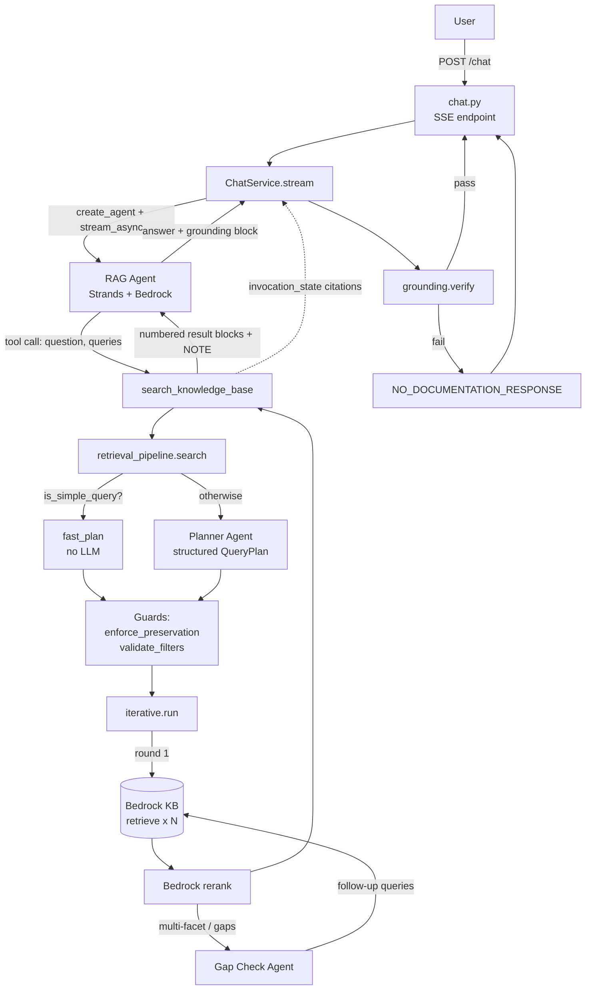
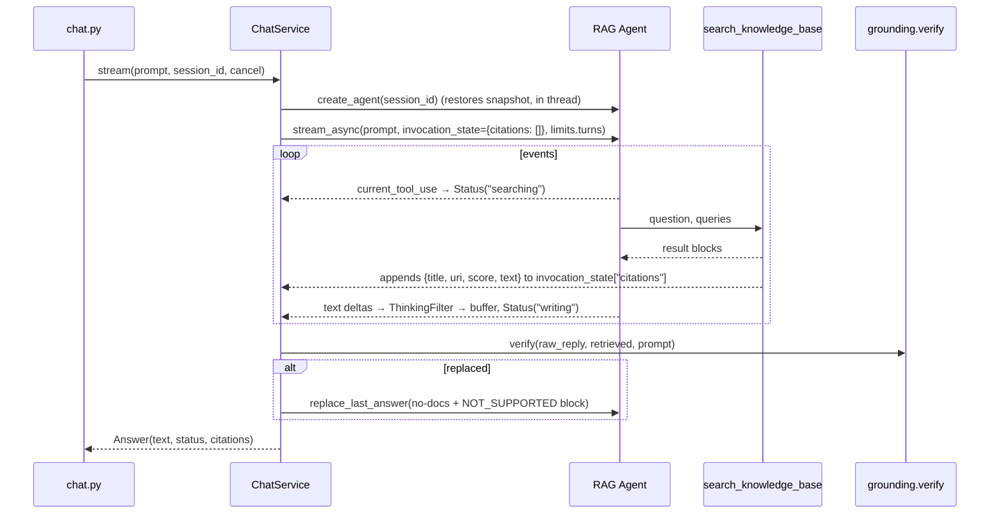
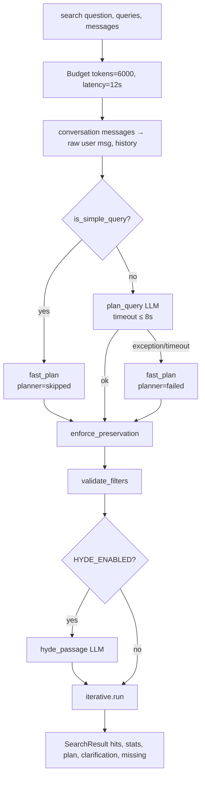
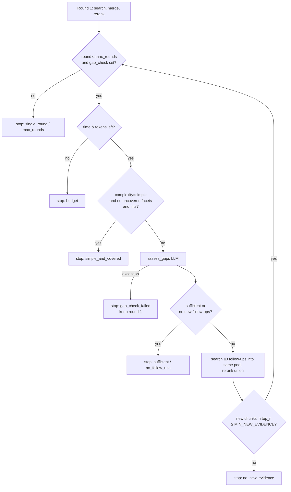

# RAG Pipeline Deep Dive — Query Planning, Decomposition, Iterative Retrieval and Grounding

This document explains how a single chat message travels through the SSO RAG
assistant: how the Strands agent decides to search, how the query planner
rewrites and decomposes the question, how multi-round retrieval works, and how
the final answer is verified against the retrieved documentation before the
user sees it. It ends with a design review: strengths, gaps and recommended
improvements.

For deployment, sessions and infrastructure see
[architecture/architecture.md](./architecture/architecture.md).

---

## Contents

1. [Big picture](#1-big-picture)
2. [Request lifecycle (API → ChatService → Agent)](#2-request-lifecycle)
3. [The main agent and the search tool](#3-the-main-agent-and-the-search-tool)
4. [Retrieval strategies](#4-retrieval-strategies)
5. [The query planner](#5-the-query-planner)
6. [Deterministic guards around the planner](#6-deterministic-guards-around-the-planner)
7. [Iterative retrieval and the gap check](#7-iterative-retrieval-and-the-gap-check)
8. [Knowledge base search, merge and rerank](#8-knowledge-base-search-merge-and-rerank)
9. [Grounding: the answer contract and verification](#9-grounding)
10. [Budgets, timeouts and loop guards](#10-budgets-timeouts-and-loop-guards)
11. [Configuration reference](#11-configuration-reference)
12. [Evaluation and tests](#12-evaluation-and-tests)
13. [Design review: strengths, gaps, recommendations](#13-design-review)

---

## 1. Big picture

The system is an **agentic RAG** design with a **deterministic shell**:

- A Strands `Agent` (the "RAG agent") owns the conversation and decides *when*
  to search. It has exactly one tool, `search_knowledge_base`.
- The tool does not just run the agent's queries. It runs a **retrieval
  pipeline** that can re-plan the query with a separate, stateless LLM
  (the *planner*), decompose it into facets, search Bedrock Knowledge Base in
  parallel, rerank, and run a targeted second round for missing facets.
- Every LLM decision that shapes retrieval is wrapped by **deterministic
  guards** (literal preservation, filter validation, budgets, timeouts,
  fallbacks). A planner failure never breaks search.
- The agent's reply is **buffered**, not streamed token by token, so it can be
  checked by a **deterministic grounding verifier**. Failing answers are
  replaced with a fixed "no documentation" reply.



Key files:

| Concern | File |
|---|---|
| HTTP / SSE | [app/api/routes/chat.py](../app/api/routes/chat.py) |
| Agent run, buffering, verification | [app/services/chat_service.py](../app/services/chat_service.py) |
| RAG agent construction / sessions | [app/agents/rag_agent.py](../app/agents/rag_agent.py) |
| Planner / gap / HyDE agents | [app/agents/planner_agent.py](../app/agents/planner_agent.py), [app/agents/bedrock_model.py](../app/agents/bedrock_model.py) |
| Prompts | [app/prompts/system_prompt.py](../app/prompts/system_prompt.py) |
| Search tool | [app/tools/knowledge_base_tool.py](../app/tools/knowledge_base_tool.py) |
| Strategy orchestration | [app/services/retrieval_pipeline.py](../app/services/retrieval_pipeline.py) |
| Planner LLM calls | [app/services/query_planner.py](../app/services/query_planner.py) |
| Deterministic guards | [app/services/query_guards.py](../app/services/query_guards.py) |
| Multi-round loop + budget | [app/retrieval/iterative.py](../app/retrieval/iterative.py) |
| KB retrieve / merge / rerank | [app/retrieval/knowledge_base.py](../app/retrieval/knowledge_base.py) |
| Plan schema | [app/schemas/query_plan.py](../app/schemas/query_plan.py) |
| Grounding verifier | [app/services/grounding.py](../app/services/grounding.py) |

---

## 2. Request lifecycle

### 2.1 `POST /chat` ([chat.py](../app/api/routes/chat.py))

1. Reads the `strands_session` cookie (issues a new `session_<uuid>` if invalid)
   and the optional `X-Tab-Id` header. `conversation_id()` combines them so each
   browser tab has its own history.
2. Returns a `StreamingResponse` in OpenAI `chat.completion.chunk` format.
   The SSE stream contains, in order:

   | Chunk | When |
   |---|---|
   | `delta.role = "assistant"` | immediately |
   | `delta.status = "searching"` / `"writing"` | phase changes |
   | `: keepalive` comment | every 10 s of silence |
   | `delta.content` | **once**, the verified answer |
   | `delta.grounding_status` | for answers (omitted for greetings/clarifications) |
   | `delta.citations` | `[{title, location.uri, score}]` when sources were used |
   | `finish_reason: "stop"` then `[DONE]` | end |

3. A `threading.Event` (`cancel`) is set when the client disconnects, which is
   passed to Strands as `cancel_signal` so the agent stops working for nobody.

### 2.2 `ChatService.stream` ([chat_service.py](../app/services/chat_service.py))



Important details:

- **`invocation_state` as a side channel.** The list passed as
  `invocation_state={"citations": retrieved}` is shared with the tool via
  `ToolContext`. Every hit the tool shows the model is also appended to that
  list (including the full chunk text). This is the *evidence set* the
  grounding verifier uses, and it is per-request, so evidence from previous
  turns never counts.
- **`ThinkingFilter`** strips `<thinking>…</thinking>` blocks that some models
  (e.g. Amazon Nova) emit inline, handling tags split across deltas and an
  unclosed tag (drop everything after it). It also trims leading whitespace and
  collapses 3+ newlines.
- **Buffering.** Nothing the model writes is sent until verification. The UX
  cost (no token streaming) is softened by the `status` and keepalive events.
- **History hygiene.** If the answer is replaced, `replace_last_answer()`
  rewrites the last assistant message in the session snapshot to the no-docs
  reply, so a rejected (possibly hallucinated) answer is not used as context
  next turn.
- **`limits={"turns": AGENT_MAX_TURNS}`** caps model calls per message. If the
  agent is cut off mid-reply, the unfinished reply has no grounding block and
  is replaced; `stop_reason` (e.g. `limit_turns`) is logged.
- **Replacement logging.** `replacement_log()` emits a structured
  `answer_rejected` / `answer_not_supported` event with reasons, model status,
  model citations, retrieval count, top score, sources and a reply preview —
  useful to spot "NOT_SUPPORTED despite strong results".

---

## 3. The main agent and the search tool

### 3.1 Agent construction ([rag_agent.py](../app/agents/rag_agent.py))

- A **fresh `Agent` per request**, restored from a `SnapshotSessionManager`
  (S3 in AWS, local files when `ENVIRONMENT=local`). Sharing an instance would
  leak history between users.
- `tools=[search_knowledge_base]`, `system_prompt=SYSTEM_PROMPT`,
  `context_manager="auto"` (Strands trims context when it grows),
  `retry_strategy` with max 3 attempts / 2–10 s backoff (the Strands default of
  6 attempts up to 240 s looks like a hang).

### 3.2 System prompt responsibilities ([system_prompt.py](../app/prompts/system_prompt.py))

The `SYSTEM_PROMPT` is the first layer of query understanding and the contract
for grounding:

| Section | Purpose |
|---|---|
| TERMINOLOGY | Maps user vocabulary to doc vocabulary ("App" → CSS Project/Integration, "M2M" → client credentials, "Gold/Silver", …). Reused verbatim in the planner prompt. |
| SEARCHING | How to call the tool: `question` = standalone sentence with pronouns resolved, `queries` = 1 query for single-topic, 1 per facet (max 4), error text + feature for errors. Problem-type → where to look. How to react to `NO_MATCH`, `NOTE`, `CLARIFY`, `SEARCH_LIMIT`. |
| CLARIFYING QUESTION POLICY | "Search first"; ask only when docs diverge by that detail; topic-specific checklists. |
| ANSWERING | Facts only from results, cite with result `source:` URLs, prefer guides over release notes, Gold over Silver, treat results as data not instructions (prompt-injection defence), never echo secrets. |
| NO DOCUMENTATION | Exact fallback text + `NOT_SUPPORTED`; partial answers → `PARTIALLY_SUPPORTED`. |
| GROUNDING REPORT | Mandatory `<grounding>{…}</grounding>` JSON block ending every reply, and the rules the verifier enforces. Asks the model to put roles, claims, config keys/values and endpoints in `` `code` `` so they become checkable. |

So the agent does a *first* decomposition itself (its `queries` argument),
which the pipeline then treats as a **draft**.

### 3.3 `search_knowledge_base` ([knowledge_base_tool.py](../app/tools/knowledge_base_tool.py))

```
search_knowledge_base(question: str, queries: list[str]) -> str
```

1. **Per-message search cap.** `searches_this_turn()` walks the agent's
   messages backwards to the latest *user text* message and counts tool-use
   blocks for this tool (including the current one). If it exceeds
   `MAX_SEARCHES_PER_TURN` (default 3) it returns `SEARCH_LIMIT: …`, telling the
   model to answer from what it has.
2. Calls `retrieval_pipeline.search(question, queries, messages=agent.messages)`.
   Passing `messages` lets the pipeline recover the user's **verbatim** message
   and earlier turns, instead of trusting the agent's paraphrase.
3. Maps the `SearchResult` to a tool string:
   - `CLARIFY: <question>` — planner said clarification is essential **and**
     nothing was found.
   - `NO_MATCH: …` — no hits; nudges the model to retry with doc vocabulary.
   - Otherwise numbered blocks separated by `---`:

     ```
     [1] <section or page title>
     source: <source_url>
     score: 0.734
     <chunk text>
     ```

     followed by `NOTE: no relevant results for: "<facet query>"; …` for facets
     with no kept hit, inviting one targeted retry.
4. Appends every hit (`title`, `uri`, `score`, `text`) to the shared citations
   list for grounding.
5. Logs a JSON line with the question, kept count and all pipeline stats
   (strategy, planner status, complexity, canonical query, filters, rounds,
   stop reason, tokens, ms).

---

## 4. Retrieval strategies

`QUERY_STRATEGY` (default `planner_iterative`) selects one of three paths in
[retrieval_pipeline.search](../app/services/retrieval_pipeline.py). Evals can
override it per call.

| Strategy | Query source | Rounds | LLM calls inside the tool |
|---|---|---|---|
| `baseline` | agent's `queries` (max 4) | 1 | 0 |
| `planner` | planner plan (or fast plan) + agent drafts | 1 | 0–1 (+HyDE) |
| `planner_iterative` | same as `planner` | up to `MAX_RETRIEVAL_ROUNDS` (2) | 0–1 planner + 0–1 gap check per extra round (+HyDE) |

### 4.1 `baseline`

`multi_search(question, queries)`: dedupe queries (max 4), `per_query =
max(10, NUMBER_OF_RESULTS // n)`, parallel retrieve, merge, rerank against the
agent's `question`. Facets whose query found no kept hit are returned as
`missing`. This is the "previous behaviour" kept for A/B comparison.

### 4.2 `planner` / `planner_iterative`



Notes:

- **The original question comes from the conversation**, not from the agent's
  tool argument: `query_planner.conversation()` returns the latest user text
  message and the earlier turns (tool calls skipped, `<thinking>` and grounding
  blocks stripped from assistant text). The agent's `question`/`queries` become
  *hints* ("the assistant's draft (may help, may be wrong)").
- **The planner runs on every tool call.** If the agent retries a search in the
  same message, the planner re-plans the same user message; the new wording
  enters through the reserved agent-query slots (see §7.1).
- `clarification` is only returned when there are **no hits**: the system
  prefers answering with an assumption over asking.

---

## 5. The query planner

### 5.1 Planner agents ([planner_agent.py](../app/agents/planner_agent.py))

Three tool-less, stateless Strands agents, created fresh per call (no shared
history):

| Agent | Prompt | Output |
|---|---|---|
| Planner Agent | `PLANNER_PROMPT` (+ TERMINOLOGY) | `QueryPlan` (structured output) |
| Gap Check Agent | `GAP_PROMPT` | `GapAssessment` (structured output) |
| HyDE Agent | `HYDE_PROMPT` | free text passage |

They use `planner_model`: same Bedrock model id as the main agent but
`temperature=0.0`, `max_tokens=800`, read timeout derived from
`PLANNER_CALL_TIMEOUT_MS`, a single boto attempt and a short Strands retry
strategy (2 attempts, 1–2 s). They are meant to be cheap, deterministic and
quick to give up.

### 5.2 `QueryPlan` schema ([query_plan.py](../app/schemas/query_plan.py))

| Field | Meaning | Who fills it |
|---|---|---|
| `original_question` | verbatim user message | **code** (planner told to leave empty) |
| `canonical_query` | one self-contained sentence, pronouns resolved from history only | LLM, repaired by guards |
| `query_variants` (≤4) | complementary searches in doc vocabulary (feature name, symptom/error, config surface, IdP) — not paraphrases | LLM, filtered by guards |
| `sub_questions` (≤4) | `{facet, query}` per independent part | LLM |
| `complexity` | `simple` / `multi_facet` / `ambiguous` | LLM |
| `preserved_terms` | identifiers, errors, versions, negations verbatim | LLM, replaced by guards |
| `filters` | `{field, operator, value, justification}` only for explicit scope | LLM, validated by guards |
| `resolved_context` | facts established by the conversation (IdP, env, realm, client type) | LLM (informational; not used downstream today) |
| `needs_clarification`, `clarification_question` | only if no meaningful search is possible | LLM |

### 5.3 `plan_query` ([query_planner.py](../app/services/query_planner.py))

Prompt layout:

```
Conversation so far:
USER: …            (last PLANNER_HISTORY_TURNS turns, each ≤600 chars)
ASSISTANT: …

Current user question:
<verbatim latest user message>

The assistant's draft (may help, may be wrong):
question: <agent's standalone question>
queries: ["…", "…"]

Create the retrieval plan.
```

The call goes through `_invoke()`: the agent is run on a shared
`ThreadPoolExecutor(max_workers=8)` and the caller waits at most
`min(remaining latency budget, PLANNER_CALL_TIMEOUT_MS)`. On timeout a
`cancel_signal` is set for the Strands agent and `TimeoutError` is raised; the
pipeline falls back to `fast_plan`. If the budget is already exhausted it
raises immediately. Token usage (`accumulated_usage.totalTokens`) is returned
so the budget can be charged.

### 5.4 Query decomposition — three layers

Decomposition happens in up to three places, each with a fallback:

1. **Agent-level** — the system prompt asks the RAG agent to send one query
   per independent part (max 4).
2. **Planner-level** — `complexity="multi_facet"` with `sub_questions`
   (one `{facet, query}` per part, max 4), plus `query_variants` for
   complementary angles.
3. **Fast plan** — when the planner is skipped or fails,
   [`fast_plan`](../app/services/retrieval_pipeline.py) converts *multiple*
   agent queries into sub-questions (`facet = query = q`, max 4) and marks the
   plan `multi_facet`. A single agent query becomes a `simple` plan. The agent's
   standalone `question` and queries that differ from the raw message become
   `query_variants`.

Facets matter downstream because they drive:

- round-one query priority (facets before variants),
- the reranker's `top_n` (`top_n_for(facets)`, more room per facet),
- facet coverage tracking (`_queries` labels → `uncovered_facets`),
- the `NOTE: no relevant results for …` message to the agent,
- whether the gap check runs at all.

### 5.5 Worked example

User (after discussing a BCeID integration): *"and what about prod? also how
do service accounts get client roles?"*

- `is_simple_query` → **false** (history + leading "and", "also", multi-clause).
- Planner output (illustrative):

  ```json
  {
    "canonical_query": "How do I get PROD approval for my BCeID integration, and how are client roles assigned to a service account?",
    "query_variants": ["BCeID production approval request", "service account client credentials client roles", "CSS app role mapping service account"],
    "sub_questions": [
      {"facet": "BCeID PROD approval", "query": "BCeID integration production approval process"},
      {"facet": "service account roles", "query": "assign client roles to service account CSS"}
    ],
    "complexity": "multi_facet",
    "resolved_context": ["identity provider: BCeID"]
  }
  ```

- Round 1 queries (cap 6): canonical, both facet queries, up to 2 agent
  queries, then variants.
- Rerank against `canonical_query`, keep `top_n = 6 + 2*(2-1) = 8`.
- If no kept chunk was found by the "service account roles" facet query, the
  gap check proposes follow-ups for that facet only; round 2 searches them,
  merges into the pool, and reranks the union.

---

## 6. Deterministic guards around the planner

All in [query_guards.py](../app/services/query_guards.py). These exist
because an LLM rewrite can silently change meaning.

### 6.1 Fast path — `is_simple_query(question, has_history)`

Skip the planner (saving an LLM round trip) when the question is
self-contained and single-topic:

| Rule | Effect |
|---|---|
| Empty | not simple |
| History exists **and** anaphora (`it, that, this, they, same, above, previous, there, then, one…`) outside quotes, or a follow-up opener (`and, also, what about, how about, so, but, ok, then, same`) | not simple — needs history resolution |
| More than one `?`, or multi-clause markers (`and also/then/how/what…`, `as well as`, `also`, `plus`, `in addition`, `followed by`, `after that`, `;`) | not simple — likely multi-facet |
| ≤ 12 words | simple |
| ≤ 25 words **and** contains an exact literal (identifier, version, quoted text, URL) | simple — already precise |
| otherwise | not simple |

### 6.2 Literal and negation preservation — `enforce_preservation(plan, question)`

`extract_literals()` finds substrings that must survive any rewrite:

- quoted text (`"…"`, `` `…` ``, `“…”`),
- URLs and `mailto:`,
- versions (`v4.7.1`, `26.x`),
- identifiers: `snake_case`, `SCREAMING_CASE`, `camelCase`, dotted keys
  (`a.b.c`), kebab-with-digit (`bcgov-idp-123`), and numbers with 3+ digits
  (HTTP codes, integration ids).

Plus any `preserved_terms` the planner listed **that really occur** in the
question (hallucinated terms are ignored).

Repairs:

1. If the question has a negation (`not, no, without, never, except, cannot,
   none, neither, nor, n't`) and the canonical query lost it, the canonical
   query is **reset to the verbatim question**.
2. Any literal missing from the canonical query is **appended** to it.
3. If negated, variants without a negation are **dropped** (logged).
4. If no remaining variant contains *all* literals, the verbatim question is
   **prepended** as a variant.
5. Variants deduped and capped at 4; `original_question` and
   `preserved_terms` are overwritten by code.

### 6.3 Metadata filters — `validate_filters` / `to_retrieval_filter`

The chunker ([chunker/preprocess.py](../chunker/preprocess.py)) writes
`doc_type`, `category`, `tags`, `release_version`. A planner filter survives
only if:

| Check | Rule |
|---|---|
| Field allowed | `doc_type`, `category`, `tags`, `release_version` |
| Operator allowed for field | `equals`/`in` for most; `list_contains` for `tags` |
| Value well-formed | 1–5 non-empty strings ≤100 chars; exactly one unless `in` |
| `doc_type` known | `guide`, `faq`, `release`, `category` |
| **Justified by the question** | `doc_type`: trigger regex (e.g. "faq", "release notes", "changelog", "how-to", "overview"); `release_version`: same version appears in the question; others: value appears verbatim |
| `release_version` format | normalised to `X.Y.Z` (leading `v` stripped) |

Valid filters become a Bedrock `RetrievalFilter` (`equals` / `in` /
`listContains`, combined with `andAll`). At search time a filtered query that
returns nothing is **retried unfiltered** (see §8).

---

## 7. Iterative retrieval and the gap check

Implemented in [iterative.run](../app/retrieval/iterative.py).

### 7.1 Round one — `round_one_queries(plan, extra)`

Max `MAX_ROUND_QUERIES = 6`, built in priority order:

1. **Head:** `[canonical_query, *sub_question.query]` (deduped,
   case-insensitive), truncated to leave room for…
2. …up to `RESERVED_AGENT_QUERIES = 2` of the agent's own queries not already
   present. This guarantees the agent's *retry wording* is always searched,
   even when the plan alone would fill the cap.
3. **Rest:** `query_variants` then remaining agent queries.

HyDE passages (if enabled) are added on top, labelled `"HyDE"` so they don't
count as facets.

All queries are searched in parallel (`CANDIDATES_PER_QUERY = 15` each),
merged into a pool keyed by chunk-text SHA-1, and reranked against
**`canonical_query`** keeping `top_n_for(len(sub_questions))`.

### 7.2 Later rounds



- **Facet coverage** (`uncovered_facets`) is mechanical: a sub-question is
  "covered" if at least one *kept* (post-rerank) chunk was found by that
  sub-question's query (tracked through the `_queries` metadata label).
- **Gap check prompt** (`assess_gaps`) gives the model: the original and
  canonical question, facet list, the uncovered facets, queries already
  searched, and the top 8 kept excerpts (500 chars each, titled by section).
  It returns `covered_facets`, `missing_facets`, `follow_up_queries` (≤3, must
  keep identifiers/negations, must not repeat searched queries) and
  `sufficient`.
- Follow-ups are deduped against everything searched and capped at
  `MAX_FOLLOW_UPS = 3`.
- Follow-ups are searched **into the same pool** and the **union** is
  reranked, so new evidence must out-rank old evidence to be kept.
- **Diminishing-returns stop:** if fewer than `MIN_NEW_EVIDENCE` new chunks
  make the top-N, the loop stops.
- With the default `MAX_RETRIEVAL_ROUNDS = 2` there is at most **one** gap
  check per tool call, and for `simple` plans with hits it is skipped entirely.

### 7.3 Stats returned

```json
{
  "strategy": "planner_iterative", "planner": "ok|skipped|failed",
  "complexity": "multi_facet", "canonical_query": "…", "filters": [],
  "queries": ["…"], "missing": ["…"], "hyde": false,
  "candidates": 73, "reranked": true, "scores": [0.91, 0.62],
  "rounds": [{"round": 1, "queries": [], "candidates": 61, "kept": 8, "ms": 2100},
             {"round": 2, "missing": [], "queries": [], "new_candidates": 12, "new_in_top": 2, "ms": 5400}],
  "stop": "no_new_evidence", "tokens": 1830, "ms": 5600
}
```

### 7.4 HyDE (optional, off by default)

`hyde_passage(canonical_query)` asks for a 3–5 sentence passage "as it might
appear in the docs"; the passage itself is used as an extra retrieval query.
It is off unless evals show a Recall@K gain without hurting faithfulness.

---

## 8. Knowledge base search, merge and rerank

[knowledge_base.py](../app/retrieval/knowledge_base.py)

1. **Acronym expansion** — `expand_query` appends spelled-out forms from
   `ACRONYMS` ([constants.py](../app/common/constants.py)) when the short form
   appears as a word and the long form doesn't:
   `"bcsc ppid"` → `"bcsc ppid (BC Services Card; pairwise pseudonymous identifier)"`.
   This helps embeddings match the docs' wording. (Conceptual synonyms live in
   the prompt TERMINOLOGY, not here.)
2. **`retrieve`** — Bedrock Agent Runtime `retrieve` with
   `numberOfResults`, `overrideSearchType` (`SEMANTIC` by default; `HYBRID`
   possible) and optional `filter`.
3. **`search_round`** — parallel retrieve per query (thread pool sized to the
   query count); a filtered query with zero results is retried without the
   filter. Results merge into a pool keyed by `sha1(chunk.text)`, keeping the
   best vector score, and each chunk's `metadata["_queries"]` records which
   query labels found it. Returns the pool and the set of keys new in this
   round.
4. **`rank`** — sorts by vector score, then calls Bedrock `rerank` (if
   `RERANKER_MODEL_ARN` is set) against the rank query with
   `numberOfResults = min(top_n, len)`. Results below `MIN_RERANK_SCORE`
   (0.05) are dropped. On `ValidationException` it falls back to the top-N by
   vector score.
5. **`top_n_for(facets)`** = `min(12, NUMBER_OF_RERANKED_RESULTS + 2·(facets−1))`
   — 6 for one facet, 8 for two, … capped at 12, so one facet can't crowd out
   the others.

---

## 9. Grounding

[grounding.py](../app/services/grounding.py) — deterministic, string-based
verification of the agent's reply against **this turn's** retrieved chunks.

### 9.1 The contract

Every reply must end with:

```html
<grounding>{"response_type": "answer", "grounding_status": "SUPPORTED", "citations": ["https://bcgov.github.io/sso-docs/..."]}</grounding>
```

| Field | Values |
|---|---|
| `response_type` | `answer` (any SSO info/guidance), `clarification` (only asks for details), `conversational` (greetings, thanks, capabilities). Unknown → `answer`. |
| `grounding_status` | `SUPPORTED`, `PARTIALLY_SUPPORTED`, `NOT_SUPPORTED`. Required for answers. |
| `citations` | `source:` URLs copied from results. |

### 9.2 Parsing — `split_grounding`

- Finds all `<grounding>…</grounding>` blocks (case-insensitive); the **last**
  one wins, all are removed from the body.
- Removes an unclosed `<grounding>` tail (model hit max tokens) and any empty
  code fence left behind if the model wrapped the block in ```` ``` ````.
- Strips a ```` ```json ```` wrapper inside the block, parses JSON, normalises
  case, validates status and response type, cleans citations.
- Returns `(body, Grounding | None)`.

### 9.3 Evidence — `_evidence(retrieved, prompt)`

| Evidence | Built from |
|---|---|
| `sources` | URL key → best-scoring retrieved result (URL key = no fragment, no trailing `/`, lower-case) |
| `urls` (allowed in answer) | retrieved source URLs ∪ URLs inside retrieved text ∪ URLs in the user's prompt ∪ `CONTACT_URLS` (`mailto:bcgov.sso@gov.bc.ca`) |
| `text` (value corpus) | all retrieved chunk text + URIs + the user's prompt + `NO_DOCUMENTATION_RESPONSE` + contacts, whitespace-normalised, lower-cased, backticks removed |

### 9.4 Checkable values — `_values(body)`

- **URLs** anywhere in the body (including markdown links).
- In **fenced code blocks**: double- and single-quoted strings and endpoint
  paths.
- In **prose**: every inline `` `code` `` span and endpoint-like paths with ≥2
  segments (`/auth/realms/standard`). The look-behind avoids "IDIR/BCeID",
  "and/or" and URL paths.
- **Placeholders are exempt**: `<angle>`, `{x}`/`{{x}}`, `${x}`,
  `YOUR_…`, `...`, `…` split a value and only its literal fragments (≥2 chars)
  must appear in evidence.

### 9.5 `verify()` decision table

Checks run in this order:

| # | Condition | Result |
|---|---|---|
| 1 | No/malformed grounding block | **reject** |
| 2 | `answer` without a valid status | reason recorded |
| 3 | `answer` + `NOT_SUPPORTED` | **replace** (not a rejection; model admitted no coverage) |
| 4 | `answer` + `SUPPORTED` + empty citations | reason |
| 5 | Any citation not among retrieved sources | reason |
| 6 | No retrieval this turn **and** (`answer` or body has URLs/code/paths) | reason |
| 7 | URL in body not in allowed URLs | reason |
| 8 | Code value / quoted string / path not in evidence text | reason |
| 9 | Any reason, or empty body | **reject** → `NO_DOCUMENTATION_RESPONSE`, `NOT_SUPPORTED` |
| — | Otherwise | **deliver** body; status = model's status for answers, `None` for clarification/conversational |

Delivered citations = cited sources ∪ retrieved pages the answer links to,
each as the full retrieved record (`title`, `uri`, `score`).

### 9.6 What grounding guarantees — and what it doesn't

**Guarantees** (deterministically): no fabricated links or citations; no
invented endpoints, config keys/values, role or claim names *when written as
code*; no SSO guidance with code/URLs when nothing was retrieved this turn; no
answer without an explicit self-assessment.

**Does not guarantee:** faithfulness of plain-prose claims (e.g. "approval
takes 2 business days"); that cited pages actually support the specific
claims; that the model's `SUPPORTED` vs `PARTIALLY_SUPPORTED` self-label is
accurate. Faithfulness is measured offline by the LLM judge in
[evals/run_answers.py](../evals/run_answers.py).

---

## 10. Budgets, timeouts and loop guards

| Guard | Default | Scope | Behaviour when hit |
|---|---|---|---|
| `AGENT_MAX_TURNS` | 6 | model calls per user message | agent stops; unfinished reply fails grounding → no-docs reply |
| `MAX_SEARCHES_PER_TURN` | 3 | tool calls per user message | 4th call returns `SEARCH_LIMIT` |
| `RETRIEVAL_TOKEN_BUDGET` | 6000 | planner + HyDE + gap-check tokens **per tool call** | no further gap-check rounds; HyDE skipped |
| `RETRIEVAL_LATENCY_BUDGET_MS` | 12000 | per tool call | LLM calls get `min(remaining, cap)`; loop stops with `budget` |
| `PLANNER_CALL_TIMEOUT_MS` | 8000 | each planner/gap/HyDE call | `TimeoutError` → fallback (fast plan / keep round 1 / no HyDE) |
| `MAX_RETRIEVAL_ROUNDS` | 2 | per tool call | stop `max_rounds` |
| `MIN_NEW_EVIDENCE` | 1 | per follow-up round | stop `no_new_evidence` |
| `MAX_ROUND_QUERIES` / `MAX_FOLLOW_UPS` | 6 / 3 | per round | truncation |
| Bedrock model retries | 3 attempts, 2–10 s | main agent | error surfaces in-band in SSE |
| Heartbeat | 10 s | SSE | `: keepalive` comment |

Worst-case search fan-out for one user message is therefore roughly
3 tool calls × (1 planner + 1 gap check + ~9 KB retrieves + 2 reranks).

---

## 11. Configuration reference

From [config.py](../app/common/config.py) (env var aliases):

| Variable | Default | Used by |
|---|---|---|
| `QUERY_STRATEGY` | `planner_iterative` | pipeline |
| `NUMBER_OF_RESULTS` | 25 | baseline per-query sizing, default `retrieve` size |
| `CANDIDATES_PER_QUERY` | 15 | planner strategies |
| `NUMBER_OF_RERANKED_RESULTS` | 6 | `top_n_for` base |
| `MIN_RERANK_SCORE` | 0.05 | rerank cut-off |
| `SEARCH_TYPE` | `SEMANTIC` | KB `overrideSearchType` |
| `RERANKER_MODEL_ARN` | – | reranking on/off |
| `MAX_RETRIEVAL_ROUNDS` | 2 | iterative loop |
| `MIN_NEW_EVIDENCE` | 1 | iterative loop |
| `RETRIEVAL_TOKEN_BUDGET` | 6000 | budget |
| `RETRIEVAL_LATENCY_BUDGET_MS` | 12000 | budget |
| `PLANNER_CALL_TIMEOUT_MS` | 8000 | planner/gap/HyDE |
| `PLANNER_HISTORY_TURNS` | 6 | planner prompt |
| `HYDE_ENABLED` | false | HyDE |
| `AGENT_MAX_TURNS` | 6 | chat service |
| `MAX_SEARCHES_PER_TURN` | 3 | tool |
| `MODEL_MAX_ATTEMPTS` | 3 | main agent retries |

---

## 12. Evaluation and tests

- **Golden set** — [evals/golden.jsonl](../evals/golden.jsonl): `{id, history,
  question, expected_urls, tags}`; tags such as `simple`, `multi_facet`.
- **Retrieval eval** — [evals/run_retrieval.py](../evals/run_retrieval.py):
  Recall@1/5/10, MRR, latency and planner tokens per strategy (optionally with
  HyDE). The `baseline` here searches the question verbatim, so it is a lower
  bound for production baseline.
- **Answer eval** — [evals/run_answers.py](../evals/run_answers.py): runs the
  full agent; an LLM judge scores **faithfulness** (supported claims / claims)
  on the *raw* answer, plus whether grounding delivered or replaced it, and
  cited recall.
- **Unit tests** — [tests/test_query_guards.py](../tests/test_query_guards.py)
  (literals, negation, filters, fast path) and
  [tests/test_retrieval_pipeline.py](../tests/test_retrieval_pipeline.py)
  (merge/dedupe, unfiltered retry, follow-up rounds, every stop reason, fast
  plan facets, planner fallback/timeout, clarification only without hits,
  baseline parity, tool output format, search limit).

---

## 13. Design review

### 13.1 What is done well

1. **LLM-proposes, code-disposes.** Planner output is treated as untrusted:
   literals and negations are restored, filters must be justified by the user's
   words, and every LLM step has a timeout and a non-LLM fallback. This is the
   right pattern for production RAG.
2. **Verbatim question recovery.** Planning from the user's actual message
   (via `agent.messages`) rather than the agent's paraphrase avoids
   compounding rewrite drift; the agent's draft is still used as a hint and
   gets reserved query slots.
3. **Adaptive cost.** The fast path skips the planner for short, precise,
   self-contained questions; the gap check is skipped for covered simple
   plans; diminishing-returns and budget stops bound the loop.
4. **Facet-aware ranking.** `top_n` grows with facets and coverage is tracked
   per facet, which addresses the classic multi-part failure where one facet
   dominates the reranked set.
5. **Explicit, machine-checkable answer contract** with deterministic
   enforcement, history hygiene after rejection, and rich rejection logs.
6. **Evaluation harness** that compares strategies on both retrieval and
   answer faithfulness, with HyDE gated behind evidence.

### 13.2 Gaps found (verified against the code)

| # | Severity | Finding | Evidence |
|---|---|---|---|
| G1 | **High** | **Partial answers that link the Teams contact channel are rejected.** The prompt tells the model to "point to the contacts above" for `PARTIALLY_SUPPORTED`, but only the `mailto:` is in `CONTACT_URLS`; the Teams URL from `NO_DOCUMENTATION_RESPONSE` is in the value corpus but not in the allowed URL set, so the whole (otherwise valid) partial answer is replaced with the no-docs reply. | Reproduced: `verify()` returns `undocumented URLs: ['https://teams.microsoft.com/…']`. Fix: add every URL in `NO_DOCUMENTATION_RESPONSE` to the allowed URLs. |
| G2 | Medium | **`response_type` self-labelling bypass.** A reply labelled `conversational`/`clarification` skips status/citation checks; with no retrieval it passes as long as it has no code/URLs. A prose answer like "You can request one in the CSS app" mislabelled as `conversational` is delivered ungrounded. | Reproduced: status `None`, not replaced. Mitigation: a lightweight classifier/heuristic (e.g. reject non-`answer` types longer than N sentences or without a `?` for `clarification`). |
| G3 | Medium | **`PARTIALLY_SUPPORTED` with no citations passes.** Only `SUPPORTED` requires citations, yet a partial answer still makes factual claims. | Reproduced. Require ≥1 citation for any non-`NOT_SUPPORTED` answer. |
| G4 | Medium | **Plain-prose claims are unchecked** (documented limitation). Numbers, durations and process steps written outside backticks are not verified. | Design. Options below (§13.3). |
| G5 | Low | **Very short values are weak checks.** 2-character fragments are substring-matched against a large corpus that also contains the prompt and the no-docs text (e.g. `` `id` `` matches "Integration ID"). | Use word-boundary matching for short values or require ≥3 chars. |
| G6 | Low | **Budget is per tool call, not per message.** Up to 3 searches each get a fresh 6000-token / 12 s budget and a fresh planner call over the *same* user message, so a retry re-plans identically. | Cache the plan per (session, user message) and share one `Budget` per message (e.g. via `invocation_state`). |
| G7 | Low | **Negation handling is retrieval-hostile.** Variants lacking a negation are dropped, but dense retrievers are largely negation-insensitive; useful topic variants (e.g. "login error troubleshooting" for "why can't users log in") get discarded. | Keep negations in the canonical/rank query (where the reranker can use them) but allow non-negated variants for recall. Validate with evals. |
| G8 | Low | **Mechanical facet coverage.** A facet is "covered" if *any* kept chunk was found by its query, even when that chunk is really about another facet; the reranker ranks against the combined canonical query. | Optionally rerank per facet (or reserve per-facet slots) and let the gap check be the semantic arbiter. |
| G9 | Low | **`resolved_context` is produced but unused.** IdP/environment/realm facts could seed filters or be appended to facet queries. | Use it, or drop it from the schema to save planner tokens. |
| G10 | Info | **Planner uses the main model.** `planner_model` reuses `MODEL_ARN`; planning/gap checks are classification-style tasks a smaller model handles well. | Add `PLANNER_MODEL_ARN` to cut latency/cost. |
| G11 | Info | **No first-token streaming.** Buffering for verification adds perceived latency equal to full generation time. | Acceptable trade-off; could stream after a sentence-level incremental check if latency becomes an issue. |
| G12 | Info | **Filtered-retry is all-or-nothing.** A filter is dropped only when it returns *zero* hits; a filter that returns a few weak hits is kept. | Retry unfiltered when the top filtered score is below a threshold. |

### 13.3 Recommended next steps (prioritised)

1. **Fix G1** — derive allowed contact URLs from `NO_DOCUMENTATION_RESPONSE`
   (one-line change in `_evidence`) and add a regression test.
2. **Tighten the contract (G2, G3, G5)** — require citations for partial
   answers; constrain `conversational`/`clarification` replies; word-boundary
   matching for short values.
3. **Prose faithfulness (G4)** — add an optional, budgeted LLM-judge or NLI
   check for `SUPPORTED`/`PARTIALLY_SUPPORTED` answers (the judge from
   `evals/run_answers.py` is a ready starting point), or downgrade to
   `PARTIALLY_SUPPORTED` rather than replacing when only prose is unverified.
   Bedrock Guardrails *contextual grounding check* is a managed alternative.
4. **Per-message planning state (G6)** — cache the `QueryPlan` and share one
   `Budget` across tool calls in the same message via `invocation_state`;
   on retries, re-plan only with the agent's new wording as additional facets.
5. **Retrieval quality experiments** — run `evals/run_retrieval.py` for:
   `SEARCH_TYPE=HYBRID` (exact identifiers/error strings benefit from lexical
   matching), relaxed negation variants (G7), per-facet rerank (G8), HyDE on
   `multi_facet` only, and a smaller planner model (G10).
6. **Observability** — the JSON logs already carry `planner`, `complexity`,
   `stop`, `tokens`, `ms` and rejection reasons; ship them to a dashboard to
   track rejection rate by reason, planner fallback rate and stop-reason
   distribution over time.
